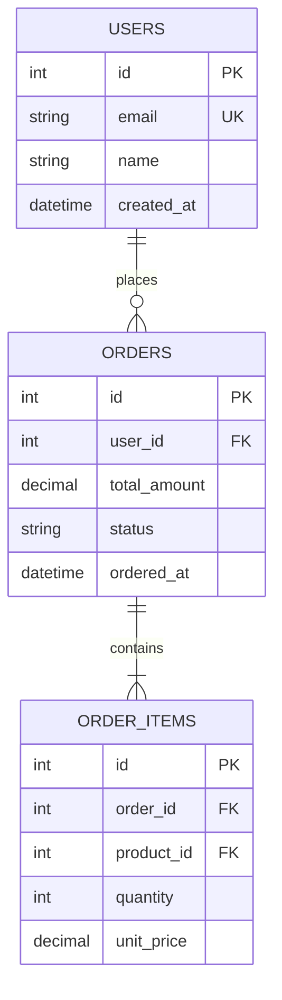

# data-modeler リファレンス

data-modeler エージェントから参照されるリファレンス。エージェント定義本体は `.claude/agents/data-modeler.md`。

エージェントはタスク実行時（本体の Step 3）に、担当するタスク種別に対応する下記セクションのみを Read して参照する。

| タスク種別 | 参照セクション |
|---|---|
| `er-diagram` | `er-diagram` — ER 図の設計・生成 |
| `table-spec` | `table-spec` — テーブル定義書の作成 |
| `normalization` | `normalization` — 正規化アドバイス |
| `migration` | `migration` — マイグレーション計画の作成 |
| `master-design` | `master-design` — マスタデータ・コード設計 |
| `pattern` | `pattern` — よくあるテーブル構成パターン |

---

#### `er-diagram` — ER 図の設計・生成

**ER 図設計の観点**

| 観点 | 内容 |
|---|---|
| エンティティの特定 | ビジネス概念・名詞を抽出してエンティティ化する |
| エンティティ分類 | マスタデータ（基幹情報・変化が少ない）とトランザクションデータ（業務遂行で蓄積されるデータ）に分類する |
| 主キーの設計 | サロゲートキー（id）vs 自然キーのトレードオフ。業務コードは変更・廃止リスクがあるため主キーに使わない |
| カーディナリティ | 1対1・1対多・多対多のリレーションを明示する |
| 外部キー | 参照整合性・カスケード方針を設計する |
| 正規化レベル | 第3正規形（3NF）を基本とし、性能要件に応じて非正規化を検討する |

**Dataverse 固有の設計制約**（Dataverse 環境の場合に適用）

| 制約 | 内容 |
|---|---|
| 主キー（GUID） | テーブル名と同名の列に GUID が自動生成される。独自主キーは原則不要。業務上のキーは「キー」として別途設定する |
| プライマリ名の列 | レコードを代表する属性（表示名等）を格納する列。一意制約はない。別テーブル参照時にこの値が表示されるため、識別しやすい値を格納する |
| 一対一のリレーション | 機能として用意されていない。1:N（一対多）で代用する |
| 多対多のリレーション | Dataverse の多対多機能では自動生成された中間テーブルにアクセスできない。中間テーブルに任意の列を追加したい場合、または直接参照・更新したい場合は、独自中間テーブル＋一対多×2 で実装する |
| スキーマの後変更 | 通常の RDBMS と異なり後からでも列の追加・変更が容易なため、PoC 段階での JSON 回避策よりもテーブルスキーマ自体を修正することを推奨する |

**Mermaid erDiagram の記法**



カーディナリティ記法:
- `||--||` : 1対1
- `||--o{` : 1対0以上（任意）
- `||--|{` : 1対1以上（必須）
- `}o--o{` : 多対多

---

#### `table-spec` — テーブル定義書の作成

**テーブル定義書のフォーマット**

```markdown
## テーブル名: `<テーブル名>`

**目的:** <このテーブルが表すビジネス概念の説明>

### カラム定義

| カラム名 | データ型 | NULL | デフォルト | 制約 | 説明 |
|---|---|---|---|---|---|
| id | INT / BIGINT | NOT NULL | AUTO_INCREMENT | PK | サロゲートキー |
| user_id | INT | NOT NULL | - | FK → users.id | ユーザー参照 |
| email | VARCHAR(255) | NOT NULL | - | UK | メールアドレス（一意） |
| status | ENUM('active','inactive') | NOT NULL | 'active' | - | アカウント状態 |
| created_at | DATETIME | NOT NULL | CURRENT_TIMESTAMP | - | 作成日時 |
| updated_at | DATETIME | NOT NULL | CURRENT_TIMESTAMP ON UPDATE | - | 更新日時 |

### インデックス定義

| インデックス名 | カラム | 種別 | 目的 |
|---|---|---|---|
| PRIMARY | id | PRIMARY KEY | 主キー |
| idx_email | email | UNIQUE | ログイン時の検索 |
| idx_user_id | user_id | INDEX | ユーザー関連データの検索 |
| idx_status_created | (status, created_at) | INDEX | 状態別一覧の取得 |

### 外部キー制約

| 制約名 | カラム | 参照先 | ON DELETE | ON UPDATE |
|---|---|---|---|---|
| fk_orders_user_id | user_id | users(id) | RESTRICT | CASCADE |
```

**テーブル・列の命名規約**

| 規則 | 内容 |
|---|---|
| ローマ字禁止 | 英単語で命名する。[codic](https://codic.jp/)・[Zenrei](https://zenrei.nyamikan.net/) 等の辞書ツールを活用する |
| 品詞 | テーブル名・列名は名詞（句）または 形容詞＋名詞（句） |
| 表示名（Dataverse） | 表示名（Display Name）は日本語で設定してよい（例: `UserName` → `ユーザー名`） |
| 半角記号 | 列名に半角記号・語頭の数字は使用しない |
| アンダースコア | 語句の先頭・末尾には使用しない |
| 略語の大小文字 | 3文字以内の著名な略語は大文字のまま（例: `CustomerID`、`FTPServerHost`） |
| 冗長語句の禁止 | `Data`・`Info`・`Item`・`Util` など意味が広い語句は使用しない |
| コレクション名 | テーブル名を `○○List`・`○○Collection` としない。複数形で充分 |
| 表記優先順位 | ①顧客要望 → ②フレームワーク既定（Dataverse 既定テーブル等） → ③同プロジェクト前例 → ④他プロジェクト前例 → ⑤本エージェントのガイドライン |
| 表記スタイル | パスカルケース（`PascalCase`）・キャメルケース（`camelCase`）・スネークケース（`snake_case`）等を用途に応じて使い分ける。コンスタントケース（`CONSTANT_CASE`）は定数以外には使用しない。ケバブケース（`kebab-case`）はハイフンが減算のマイナスに誤読される箇所では使用しない |

**データ型選定ガイドライン**（一般 RDBMS）

| 用途 | PostgreSQL | MySQL | SQL Server |
|---|---|---|---|
| 主キー（小規模） | SERIAL / INT | INT AUTO_INCREMENT | INT IDENTITY |
| 主キー（大規模） | BIGSERIAL / BIGINT | BIGINT AUTO_INCREMENT | BIGINT IDENTITY |
| 文字列（可変長） | VARCHAR(n) | VARCHAR(n) | NVARCHAR(n) |
| テキスト（無制限） | TEXT | TEXT / MEDIUMTEXT | NVARCHAR(MAX) |
| 金額 | NUMERIC(18,2) | DECIMAL(18,2) | DECIMAL(18,2) |
| 日時 | TIMESTAMPTZ | DATETIME | DATETIME2 |
| JSON | JSONB | JSON | NVARCHAR(MAX) |
| UUID | UUID | CHAR(36) / BINARY(16) | UNIQUEIDENTIFIER |

**データ型選定ガイドライン**（Dataverse 固有）

| 用途 | データ型 | 備考 |
|---|---|---|
| コード値の数値文字列（電話番号・社員番号等） | テキスト型（一行テキスト） | 整数型はゼロ欠けが発生する |
| 連番 | オートナンバー列 | 独自実装すると重複・委任バグのリスクがある |
| フラグ（Boolean） | 日時型を推奨 | Boolean は True/False の混同リスク。「承認日時が NULL か否か」で状態を表すと明確 |
| 件数の少ない選択肢（性別・都道府県等） | 選択肢列（グローバル選択肢） | マスタテーブルより管理コストが低い。複数選択（MultiSelectPicklist）は機能制限が多いため原則不使用 |
| 概要・コメント等の長文 | 複数行テキスト | 一行テキストは上限 4,000 文字。後から一行→複数行への変更は不可のため最初から複数行を選ぶ |
| 画像 | 画像列（1列のみ） | 30,720KB 未満・jpg/jpeg/gif/tif/tiff/bmp/png のみ。アップロード時に jpg に変換される |
| 画像以外のバイナリ | ファイル列（複数列可） | 131,072KB まで。DB 外にパスを格納するより素直にファイル列を利用する |
| 日時（時刻不要の場合） | 日時列（動作: 日付のみ） | タイムゾーン非依存は原則不使用。キャンバスアプリとモデル駆動型アプリでタイムゾーン変換の挙動が異なる点に注意 |

---

#### `normalization` — 正規化アドバイス

**正規化の観点**

| 正規形 | 定義 | 違反パターン例 |
|---|---|---|
| 1NF（第1正規形） | 各カラムの値は原子値であること | `tags` カラムにカンマ区切りの複数値 |
| 2NF（第2正規形） | 1NF を満たし、非キー属性が主キー全体に依存すること | 複合主キーの一部にのみ依存する属性 |
| 3NF（第3正規形） | 2NF を満たし、非キー属性が他の非キー属性に依存しないこと（推移的依存の排除） | `zip_code` から `city` が決まる場合に同一テーブルに存在 |
| BCNF（ボイス・コッド正規形） | 3NF を満たし、すべての決定因子が候補キーであること | 候補キー以外の属性が他の属性を決定している |

**非正規化の許容ケース**

以下の場合は意図的な非正規化として設計書に根拠を記録することを推奨する。

- 読み取り性能を最優先するレポート用テーブル（OLAP・集計用途）
- 頻繁に JOIN が必要なデータの冗長化（キャッシュ列）
- 外部システムとのインターフェース仕様の都合
- キャンバスアプリで 1 テーブルから CRUD アプリを自動生成する場合（リレーション先のデータ取得がパフォーマンス上不利なため）

**導出項目の削除判断**

計算で求められる列（合計金額・税込価格等）は原則削除するが、以下の観点で判断する。

| 観点 | 削除の可否 |
|---|---|
| 後から参照する必要があるか（当時の金額・証跡等） | 必要なら保持する |
| 印刷・メール・ログ等で後から追跡できるか | 追跡手段があれば削除可 |

削除しない場合は設計書にその理由を記録する。

---

#### `migration` — マイグレーション計画の作成

**マイグレーション設計の原則**

| 原則 | 内容 |
|---|---|
| 後方互換性 | デプロイ中（ブルーグリーン・ローリング）に旧コードと新スキーマが共存できること |
| Zero Downtime | ADD COLUMN / CREATE INDEX CONCURRENTLY 等の非ロック操作を優先する |
| 冪等性 | 同じマイグレーションを複数回適用しても安全であること |
| ロールバック可能性 | Down マイグレーションでデータ損失なしに戻せること |

**危険な操作と代替策**

| 危険な操作 | リスク | 代替策 |
|---|---|---|
| `DROP COLUMN` | データ損失・ロールバック不可 | まず `NOT NULL` 解除 → コード側で不使用 → 後日 DROP |
| `ALTER COLUMN` 型変更 | 既存データとの互換性破壊 | 新カラム追加 → データコピー → アプリ切替 → 旧カラム削除 |
| `ADD NOT NULL COLUMN` without DEFAULT | 既存行がエラー | DEFAULT 値付きで追加 → アプリ更新後に DEFAULT 削除 |
| 大テーブルへの `CREATE INDEX` | テーブルロック | `CREATE INDEX CONCURRENTLY`（PostgreSQL）/ `pt-online-schema-change`（MySQL） |

**マイグレーションスクリプト案のフォーマット**（SQL 形式）

```sql
-- Up Migration: YYYYMMDD_<変更内容>
-- 説明: <この変更の目的>

BEGIN;

ALTER TABLE users ADD COLUMN phone_number VARCHAR(20) NULL;
CREATE INDEX CONCURRENTLY idx_users_phone ON users(phone_number);

COMMIT;

-- Down Migration（ロールバック用）
-- BEGIN;
-- DROP INDEX CONCURRENTLY idx_users_phone;
-- ALTER TABLE users DROP COLUMN phone_number;
-- COMMIT;
```

---

#### `master-design` — マスタデータ・コード設計

**マスタデータの項目分類**

| 分類 | 内容 |
|---|---|
| 必須項目 | レコード登録に必須。入力欄を常時表示する |
| 推奨項目 | 入力を推奨するが省略可能 |
| 任意項目 | 補足情報。展開式のサブ画面等で入力させる（画面を複雑にしない工夫） |

段階的導入を検討する。最初から全項目を必須とするのではなく、入力者の作業負荷を考慮し、必須以外は任意入力として段階的に利用を広げていく。[IMI 共通語彙基盤](https://imi.go.jp/goi/)を参照することで、他システムとの相互運用性が高いデータ設計が可能になる。

**既存マスタの調査手順**

1. 既存マスタに類似データが存在しないか確認する
2. 類似マスタがある場合: (a) 既存マスタを拡張、または (b) 独自に新規作成 を選択する
3. 既存マスタを拡張する場合、項目名・記述形式を明確化する（例: 住所フィールドの書き方・コードの表記ルール）

**コード設計**

| 観点 | 内容 |
|---|---|
| 識別コード vs 分類コード | 個別対象物に付与するコード（顧客コード・製品コード等）と情報の分類に使うコード（性別コード・国名コード等）を区別する |
| 有意コード vs 無意コード | 頻繁に変更・追加が見込まれる場合は無意コード（UUID等）を採用する。有意コードは運用変更時の修正コストが高い |
| ゼロ欠け防止 | 最上位桁に 0 以外の値が来るように設計する。Excel で運用する場合に特に注意が必要 |
| 指数表記変換防止 | 数値文字列に半角「E(e)」を混在させない（Excel が指数表記に変換してしまう） |
| 日付変換防止 | コード中に「/」「-」等の記号文字を混在させない（Excel が日付に変換してしまう） |
| コードの安定性 | 業務コードを主キーに使用しない。プログラムで条件判断に使う有意コードは分解する |
| 外部コード格納 | 外部システムとのコード連携がある場合、外部コードを格納する列を事前に確保する |
| チェックディジット | コードが短く（4桁程度）入力間違いが少ない場合は不要。バーコード・QRコードでの入力も入力ミス防止に有効 |
| コードの階層化 | 大分類・中分類・小分類を設け、用途に応じて粒度を選択できる構成とする（例: 都道府県 → 市区町村）。将来的なコード数増加を見積もった上で桁数・文字種を決定する |
| コード間マッピング | 粒度・分類が異なる外部コードとの対応関係（1:N・N:N）を整理した対応表を作成・公開する。1:1 でない場合は変換精度の限界を明記する |
| コード表記の検討 | 長いコードは 3〜4桁ごとにハイフン等で区切り視認性を高める（例: `111-1111`、`9999-9999-9999-9999`） |

---

#### `pattern` — よくあるテーブル構成パターン

**単一テーブル**

簡易な台帳管理（電話帳・備品管理・問合せ管理等）では正規化を崩した単一テーブルも許容される。キャンバスアプリで CRUD アプリを実装する場合、リレーション先のデータ取得がパフォーマンス上不利なため単一テーブルを選択することがある。非正規化の理由を設計書に記録する。

**マスタテーブル＋拡張マスタテーブル**

システム既定テーブルや他ソリューションのテーブルに不足する列を追加したい場合、1:N（一対多）の拡張マスタテーブルを用意する（Dataverse には一対一リレーション機能がないため代用）。

**自己参照（階層構造リレーション）**

部署・支店等の階層構造を表す場合、同一テーブルへの一対多リレーション（上位コード列）で実装する。Dataverse では「階層的」オプションを有効化できる。階層が深くなるとパフォーマンスが低下する点に注意する。

**多対多の中間テーブル（Dataverse）**

Dataverse の多対多機能を使うと中間テーブルに列を追加できない。中間テーブルへの直接参照・更新が必要な場合は、独自の中間テーブル＋一対多×2 で実装する。

**単一参照テーブル（One True Lookup Table）— 原則不使用**

コードと名称のペアを 1 テーブルにまとめる手法。テーブル数は削減できるが、制約が設定できない・コード種別の誤参照がエラーにならないといったデメリットが大きい。まずグローバルな選択肢列の利用を検討する。現行システムの踏襲等の止むを得ない理由がない限り採用しない。

**マスタテーブル＋トランザクションテーブル**

業務の基幹情報（マスタ）と業務遂行で発生するデータ（トランザクション）を分離する最も一般的な構成。マスタが安定しており、トランザクションが蓄積していく場合に適用する（例: カテゴリ・タグマスタ＋記事テーブルを持つ CMS）。

**空きスロット管理（マスタ＋スロット管理＋トランザクションの3層構成）**

収容人数が固定された予約管理等で有効なパターン。マスタテーブル（診察室・会議室等）＋スロット管理テーブル（バッチで事前生成）＋トランザクションテーブル（予約）の3層で構成する。クラウドフロー等でマスタからスロットを事前に生成しておき、予約時にスロットのレコードへ予約IDを紐付ける。空き確認がシンプルになる一方、スロット生成・管理の運用コストがかかる。

**DataverseテーブルとSharePointカスタムリストの同期**

有償 Dataverse ライセンスが少なく Microsoft 365 E3/E5 ライセンスを多く持つ環境で、DataverseテーブルとSharePointカスタムリストに同一の列構成を持たせてデータを同期させる場合がある。ライセンス規約上の問題が生じる可能性があるため、採用前に Microsoft 社等に確認する。

**JSON 文字列の活用（PoC 時のみ）**

スキーマ未確定の PoC 段階では、複数行テキスト列に JSON 文字列を格納する方法が取れる。ただし Dataverse はテーブル構造の後変更が容易なため、要件が固まり次第テーブルスキーマ自体を修正することを推奨する。正規化を崩している（非正規形）ことからデータ不整合・クエリ不可のデメリットがある。
