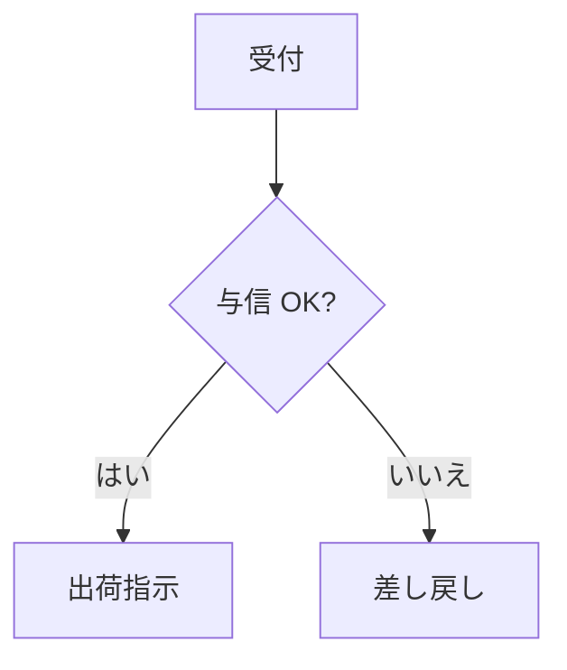
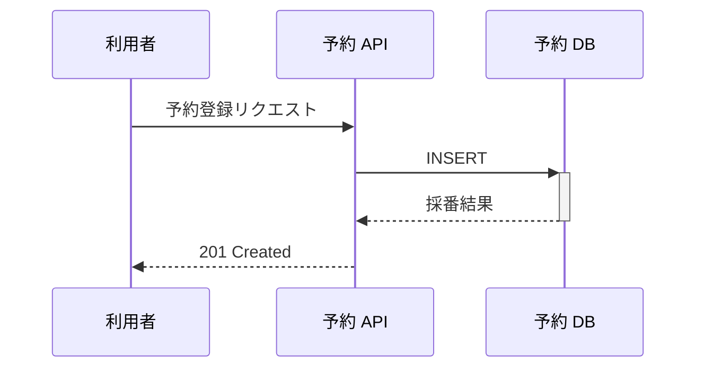
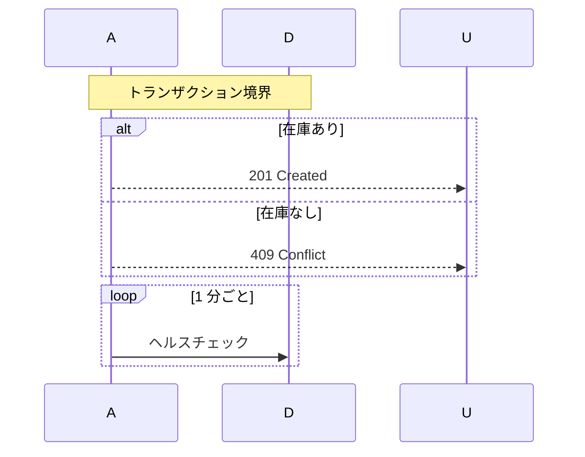
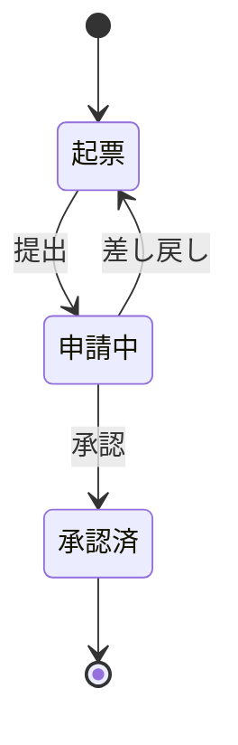
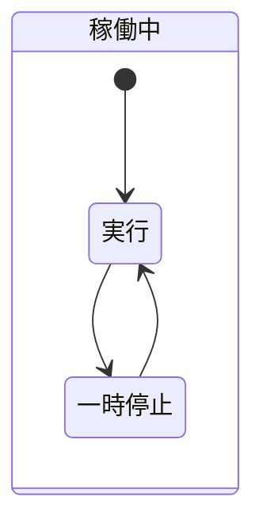
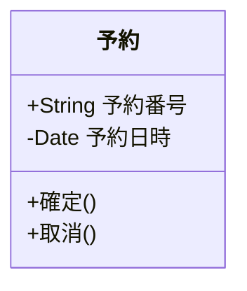
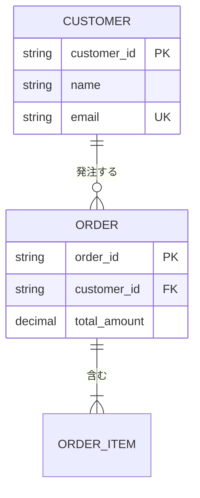

# 図種別の記法リファレンス

`beautiful-mermaid@0.1.3` が描画できるのは以下の 5 種類。Mermaid 本家が対応する gantt・pie・journey・mindmap 等は**描画されない**（パースに失敗する）。工程表を描く場合は `/visual-doc timeline` を使う。

本リポジトリの設計書に Mermaid を書くときの規約（` ` を使わない・ノード 4 つ以上は縦方向・図の中で新しい用語を導入しない・図番号とキャプションを添える）は `.claude/rules/design-docs.md`「Mermaid 図の記述規約」が正本。ここでは記法そのものだけを扱う。

---

## フローチャート（flowchart / graph）

業務フロー・処理手順・判断分岐を表す。

### ノードの形

| 記法 | 形 | 用途 |
|---|---|---|
| `[文字]` | 長方形 | 通常の処理 |
| `([文字])` | 角丸 | 開始・終了 |
| `[[文字]]` | 二重枠 | サブルーチン・別プロセス |
| `[(文字)]` | 円柱 | データベース・永続化層 |
| `((文字))` | 円 | 接続点 |
| `{文字}` | ひし形 | 判断・分岐 |
| `{{文字}}` | 六角形 | 準備・前処理 |
| `[/文字/]` | 平行四辺形 | 入出力 |

### 接続

| 記法 | 意味 |
|---|---|
| `-->` | 矢印 |
| `---` | 線（向きなし） |
| `-.->` | 点線矢印 |
| `==>` | 太い矢印 |
| `-->|ラベル|` | ラベル付き矢印 |

### 方向

`TD` / `TB`（上から下）・`BT`（下から上）・`LR`（左から右）・`RL`（右から左）。

**ノードが 4 つ以上、またはラベルが長い場合は `TD` を使う**（`design-docs.md` の規約）。`LR` は長いラベルを横一列に潰して読めなくする。

---

## シーケンス図（sequenceDiagram）

API 呼び出し・システム間連携・時系列のやりとりを表す。

### メッセージの種類

| 記法 | 意味 |
|---|---|
| `->>` | 実線の矢印（同期的な呼び出し） |
| `-->>` | 点線の矢印（応答） |
| `-x` | 実線＋×（失敗・破棄） |
| `-)` | 実線＋開いた矢印（非同期） |

`->>+` と `-->>-` の `+` / `-` は活性化バー（処理中であることを示す帯）の開始と終了。

### 注釈・分岐・繰り返し

参加者は 5〜7 に収める。それ以上になる場合は図を分割する。

---

## 状態遷移図（stateDiagram-v2）

画面遷移・申請ステータス・ライフサイクルを表す。

- 開始と終了は `[*]`
- 遷移ラベルには**イベント名**を書く（状態名を繰り返さない）
- 入れ子の複合状態は 2 階層までに留める

分岐点は `state 判定 <<choice>>` で明示できる。

---

## クラス図（classDiagram）

オブジェクトモデル・モジュール構成・型の関係を表す。

### 可視性

`+` public / `-` private / `#` protected / `~` package。

### 関連

| 記法 | 意味 |
|---|---|
| `--\|>` | 継承 |
| `--*` | コンポジション（生存期間を共有する包含） |
| `--o` | 集約 |
| `-->` | 関連（有向） |
| `..>` | 依存 |
| `..\|>` | インターフェース実装 |

多重度は `顧客 "1" --> "*" 注文` のように引用符で挟んで書く。`<<abstract>>` / `<<interface>>` でステレオタイプを付けられる。

表示する属性・メソッドは、その図で説明したいものだけに絞る。

---

## ER 図（erDiagram）

テーブル間の関連とキーを表す。

### 多重度

| 記法 | 意味 |
|---|---|
| `\|\|--\|\|` | 1 対 1 |
| `\|\|--o{` | 1 対 0 以上 |
| `\|\|--\|{` | 1 対 1 以上 |
| `}o--o{` | 0 以上 対 0 以上 |
| `}\|--\|{` | 1 以上 対 1 以上 |

### 書き方の約束

- エンティティ名は大文字、属性名は snake_case
- `PK`（主キー）・`FK`（外部キー）・`UK`（一意キー）を必ず記す
- 1 枚あたり 6〜8 エンティティまで。超える場合は業務領域で分割する
- **関連ラベルに引用符を付けない。** `beautiful-mermaid` は引用符を区切り記号として扱わず、`"発注する"` と引用符ごと描画する（標準 Mermaid と異なる。2026-08-19 実測）

命名規約（ローマ字禁止・冗長語句の禁止・業務コードを PK にしない）は `.claude/rules/code-quality.md`「DB・テーブル設計の命名規約」に従う。新規のテーブル設計そのものは `data-modeler` エージェント、既存スキーマのアンチパターン検出は `/db-review`。

---

## 共通の注意

- **日本語のノードラベルは全角 5 文字以内が目安**。枠幅が欧文字幅（1 文字 ≒ 0.55em）で計算されるため全角 6 文字以上で枠幅を超えるが、ブラウザでの判読性は保たれる（実測値と判断は `SKILL.md`「日本語で使うときの制約」）
- **1 枚あたり 50 ノード以内**に収める。超えると描画が遅くなり、読み手も追えない
- 色だけで情報を伝えない（白黒印刷とカラーバリアフリーの両方に効く）
- すべての接続にラベルを付ける
- 複雑な図には本文側に文章での説明を添える

---

> 出典: [imxv/Pretty-mermaid-skills](https://github.com/imxv/Pretty-mermaid-skills)（MIT License）の `references/DIAGRAM_TYPES.md` を日本語化し、本リポジトリの規約（`design-docs.md` の Mermaid 規約・`code-quality.md` の DB 命名規約）への参照を追加した。原典が推奨する `monokai` テーマは `beautiful-mermaid@0.1.3` に存在しないため削除した。
